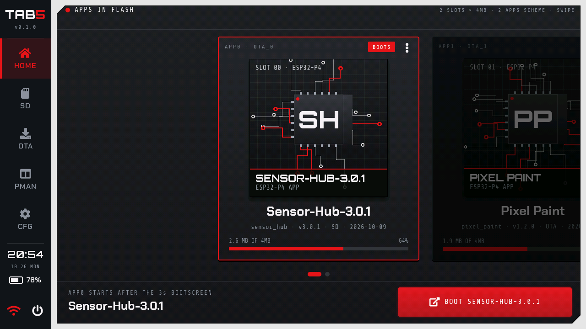

# Tab5 Launcher

An M5Launcher-style app launcher for the M5Stack Tab5 (ESP32-P4). It installs apps from the SD card and from the internet (the Tab5 firmware catalog), manages the flash partitions, and the RESET button always brings you back to the launcher. Touch UI for the 1280 × 720 screen, built with ESP-IDF 5.5 and LVGL 9.


| | |
|---|---|
|  |  |
|  |  |
|  |  |
|  |  |

*Screens rendered on a PC from the firmware's own UI code (`tools/host_test/ui_shots.py`).*

## Features

- **Boot screen:** the next app in a countdown ring, LAUNCHER, START NOW, the other apps one tap away; a tap stops the countdown.
- **HOME:** apps in flash as a carousel, choosing the boot app, BOOT. The tabs are a menu down the left edge.
- **SD:** file manager (copy, rename, new folder, delete, text viewer) and installing `.bin` files, merged images included.
- **OTA:** the Tab5 firmware catalog, downloads straight from the M5Stack server without any device identifier, favorites and your own links.
- **PMAN:** partition schemes, AUTO PARTITION, partition backup and restore.
- **CFG:** brightness, dimming and screen off, accent color, three themes (Graphite, Midnight, Daylight), Wi-Fi through the ESP32-C6, Charge Mode with the real battery state.
- **Safeguards:** boot-loop guard, a warning for apps made for older Tab5 hardware, and the Aurora Player PIN partition left untouched in every scheme.

## Install

1. Download `tab5-launcher-merged.bin` from [Releases](https://github.com/UNIZERSION/tab5-launcher/releases/latest).
2. Back up the whole Tab5 flash (16 MB):

   ```
   python -m esptool --chip esp32p4 -p COM4 read_flash 0 0x1000000 tab5-backup-16MB.bin
   ```

3. Flash the launcher with one command:

   ```
   python -m esptool --chip esp32p4 -p COM4 write_flash 0x0 tab5-launcher-merged.bin
   ```

Replace `COM4` with your Tab5's port. Flashing replaces the current firmware and partition table and erases NVS. Full user guide: [docs/GUIDE.md](docs/GUIDE.md).

## Requirements

- M5Stack Tab5 (ESP32-P4, 16 MB flash). Tested on ESP32-P4 v1.3 with the ST7121 display and ST712x touch.
- Wi-Fi: the ESP32-C6 with ESP-Hosted 2.12.x firmware. Without it everything except Wi-Fi works.
- SD card: FAT32 or exFAT.

## Building from source

You need ESP-IDF 5.5.2. In its environment, in the project folder:

```
idf.py build
idf.py -p COM4 flash
```

The components (Tab5 BSP, LVGL 9.3, ESP-Hosted) are downloaded on the first build. Host tests: `python tools/host_test/run.py` (needs gcc or zig). Development notes: [docs/DEVELOPMENT.md](docs/DEVELOPMENT.md).

## License

MIT, see [LICENSE](LICENSE). Fonts, icons and other third-party parts: [NOTICE.md](NOTICE.md).
