# Tab5 Launcher

An M5Launcher-style app launcher for the M5Stack Tab5 (ESP32-P4). It installs apps from the SD card and from the internet (the Tab5 firmware catalog), manages the flash partitions, and the RESET button always brings you back to the launcher. Touch UI for the 1280 × 720 screen, built with ESP-IDF 5.5 and LVGL 9.

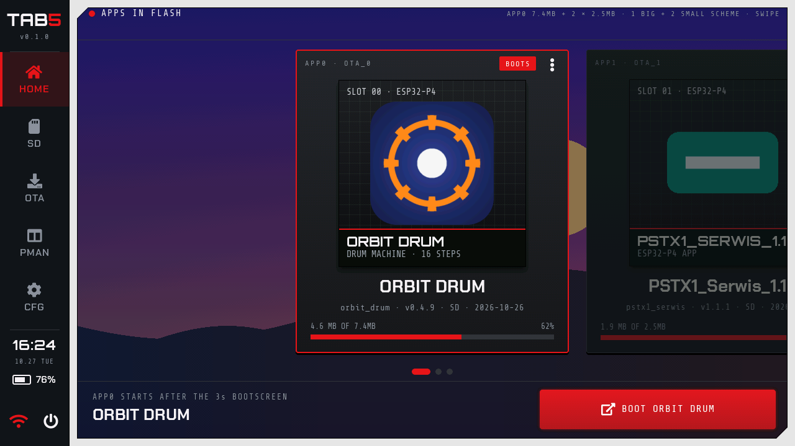

*Screens rendered on a PC from the firmware's own UI code (`tools/host_test/ui_shots.py`).*

## What's new

New since the 0.1.0 release (October 2026). It is in the source code here; the binaries come with the next release.

- **New look:** a boot screen with a countdown ring, a side menu, and the apps in flash as a swipeable HOME carousel.
- **Three themes:** Graphite, Midnight and Daylight, switched at once in CFG.
- **Slots of two sizes:** the "1 Big + 2 Small" partition scheme, one big app and two small ones.
- **App icons from the SD card:** `apps/<project>/icon.png` and a one-line description in `about.txt`.
- **Colors from the icons:** the background takes the app's color, and the **APP** accent paints the whole launcher in the boot app's color.
- **Wallpaper from the SD card:** `wallpaper.jpg` or `wallpaper.png` behind the boot screen, HOME and the idle clock.
- **Idle clock:** a large clock with the date and the battery on the dimmed screen.
- **Keyboard shortcuts like on a computer** for the M5Stack Tab5 Keyboard: Alt+1…5 for the tabs, F1 for help, F2 rename, F5 refresh, Ctrl+C / X / V, text editing with a cursor, Polish letters with Alt, type-to-find in the SD tab.

| | |
|---|---|
| 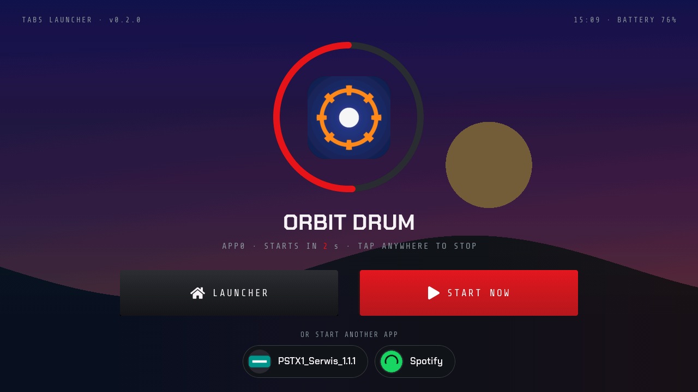<br>**Boot screen** with the countdown ring and the other apps | 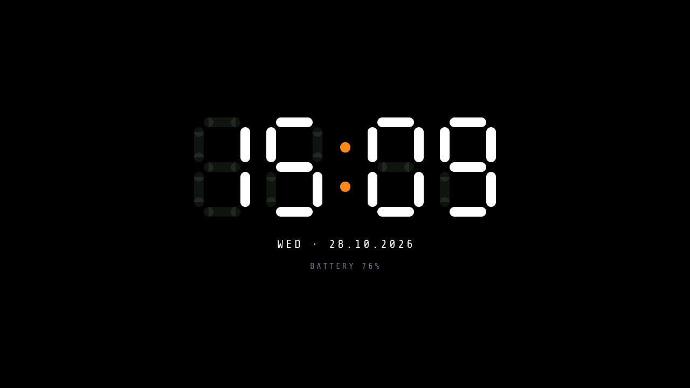<br>**Idle clock** on the dimmed screen |
| 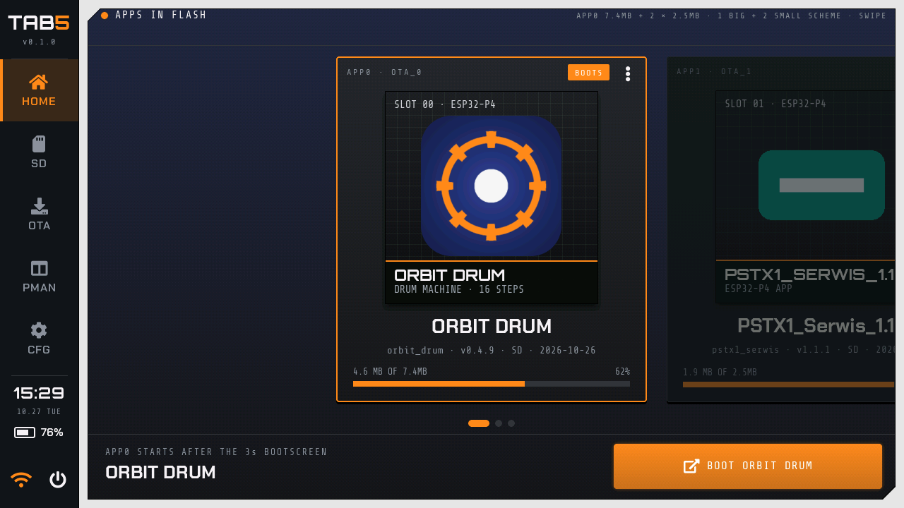<br>**APP accent:** the launcher in the boot app's color | 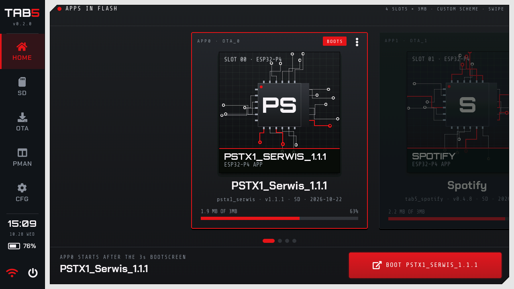<br>**HOME carousel** with four app slots |
| 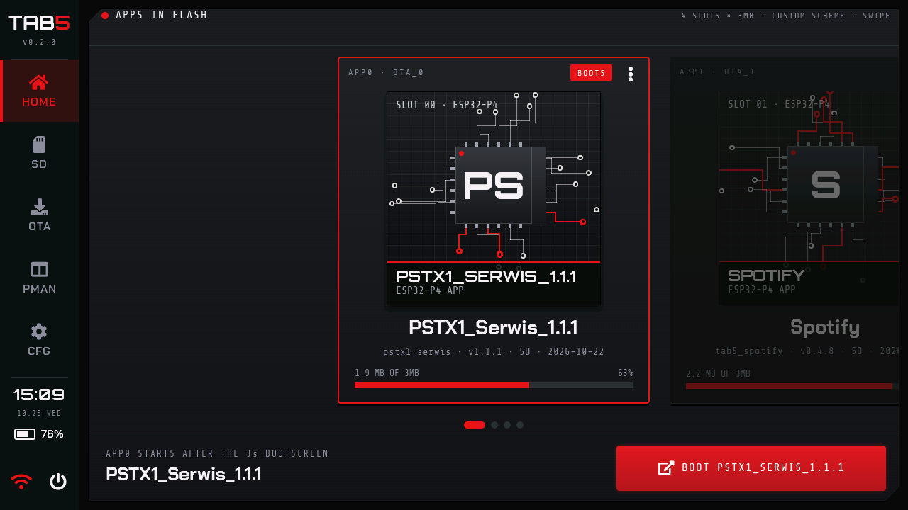<br>**Midnight** theme | 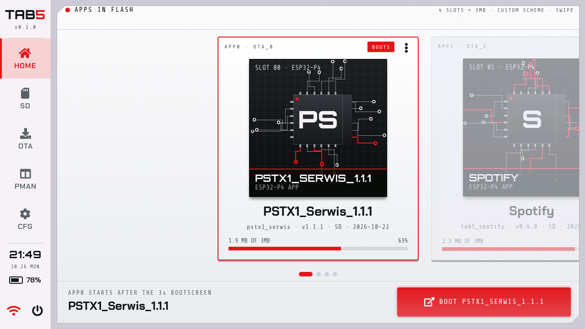<br>**Daylight** theme |
| 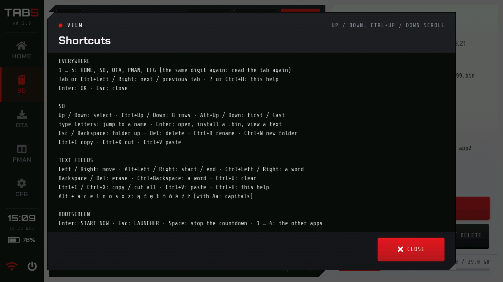<br>**F1:** the shortcuts of the tab you are in | 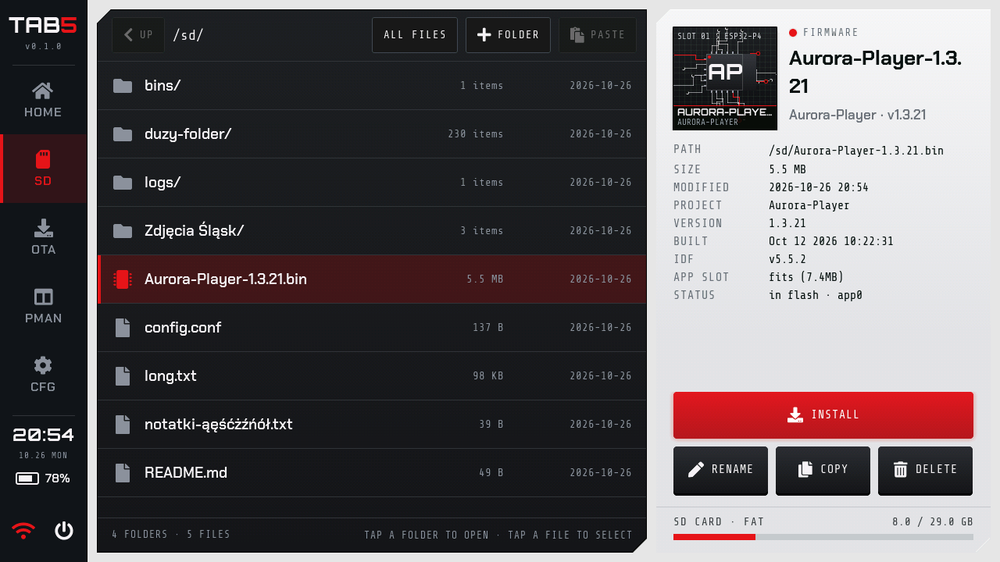<br>**SD:** the card manager |
| 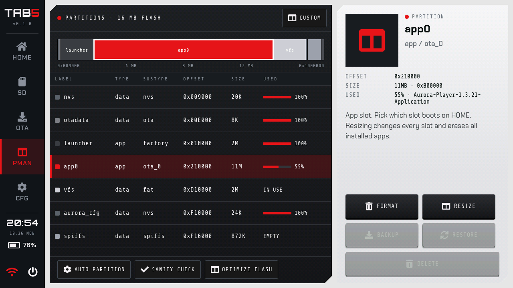<br>**PMAN:** the flash partitions | 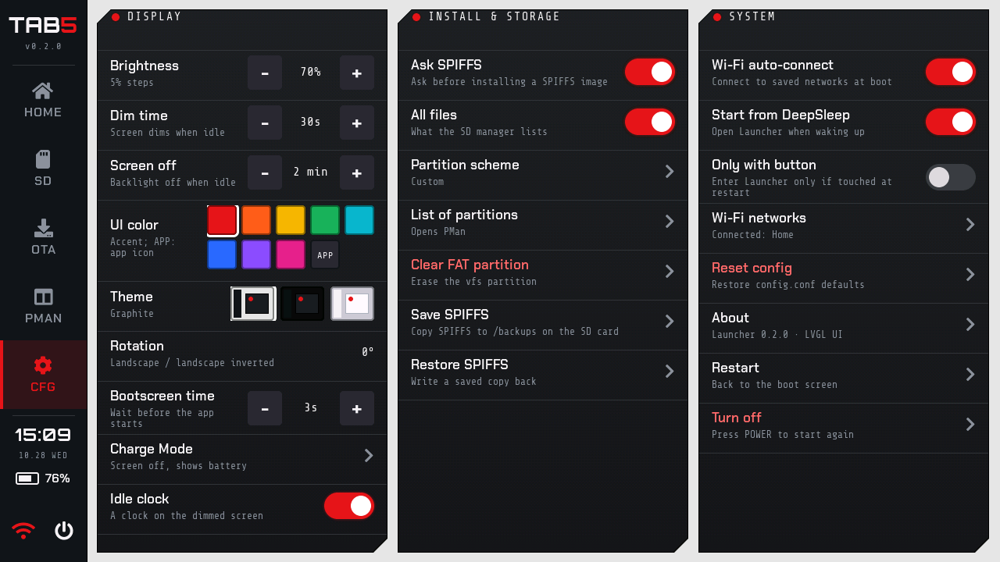<br>**CFG:** the settings |

## Features

- **Boot screen:** the next app in a countdown ring, LAUNCHER, START NOW, the other apps one tap away; a tap stops the countdown.
- **HOME:** the apps in flash as a carousel with their icons, choosing the boot app, BOOT. The tabs are a menu down the left edge.
- **SD:** file manager (copy, rename, new folder, delete, text viewer) and installing `.bin` files, merged images included.
- **OTA:** the Tab5 firmware catalog, downloads straight from the M5Stack server without any device identifier, favorites and your own links.
- **PMAN:** partition schemes (also 1 Big + 2 Small), AUTO PARTITION, partition backup and restore.
- **CFG:** brightness, dimming, idle clock and screen off, accent color (also from the app icon), three themes, Wi-Fi through the ESP32-C6, Charge Mode with the real battery state.
- **Keyboard:** the M5Stack Tab5 Keyboard works in the whole launcher, with the shortcuts of a computer.
- **Safeguards:** boot-loop guard, a warning for apps made for older Tab5 hardware, and the Aurora Player PIN partition left untouched in every scheme.

## Make it yours: files on the SD card

```
wallpaper.jpg        the wallpaper (or wallpaper.png), from 640 × 360 px up
apps/
  orbit_drum/        the app's project name, as HOME shows it under the app's name
    icon.png         its icon, 256 × 256 px looks best
    about.txt        its description: the first line
config.conf          the settings (the launcher writes it)
```

Details, sizes and formats: [App icons](docs/GUIDE.md#app-icons-from-the-sd-card), [Colors from the app icon](docs/GUIDE.md#colors-from-the-app-icon), [Wallpaper](docs/GUIDE.md#wallpaper-from-the-sd-card), [Keyboard shortcuts](docs/GUIDE.md#wi-fi-and-on-screen-keyboard).

## Install

1. Download `tab5-launcher-merged.bin` from [Releases](https://github.com/UNIZERSION/tab5-launcher/releases/latest).
2. Back up the whole Tab5 flash (16 MB):

   ```
   python -m esptool --chip esp32p4 -p COM4 read_flash 0 0x1000000 tab5-backup-16MB.bin
   ```

3. Flash the launcher with one command:

   ```
   python -m esptool --chip esp32p4 -p COM4 write_flash 0x0 tab5-launcher-merged.bin
   ```

Replace `COM4` with your Tab5's port. Flashing replaces the current firmware and partition table and erases NVS. Full user guide: [docs/GUIDE.md](docs/GUIDE.md).

The 0.1.0 release does not have the features under [What's new](#whats-new) yet: to try them now, build the launcher from source (below). They pass the PC tests, but most of them have not been tested on a Tab5 yet ([list](docs/GUIDE.md#limitations-and-plans)).

## Requirements

- M5Stack Tab5 (ESP32-P4, 16 MB flash). Tested on ESP32-P4 v1.3 with the ST7121 display and ST712x touch.
- Wi-Fi: the ESP32-C6 with ESP-Hosted 2.12.x firmware. Without it everything except Wi-Fi works.
- SD card: FAT32 or exFAT.
- Optional: the M5Stack Tab5 Keyboard.

## Building from source

You need ESP-IDF 5.5.2. In its environment, in the project folder:

```
idf.py build
idf.py -p COM4 flash
```

The components (Tab5 BSP, LVGL 9.3, ESP-Hosted) are downloaded on the first build. Host tests: `python tools/host_test/run.py` (needs gcc or zig). Development notes: [docs/DEVELOPMENT.md](docs/DEVELOPMENT.md).

## License

MIT, see [LICENSE](LICENSE). Fonts, icons and other third-party parts: [NOTICE.md](NOTICE.md).
