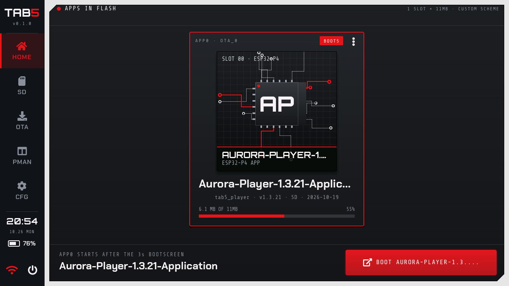
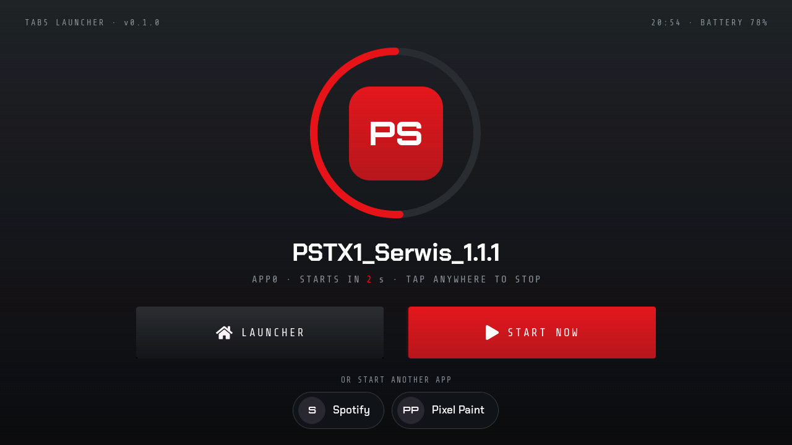

# Tab5 Launcher — user guide



*Screens rendered on a PC from the launcher's own UI code.*

## What Tab5 Launcher is

Tab5 Launcher is an app launcher for the M5Stack Tab5: it keeps apps (firmware) in flash and lets you choose which one to run. It is modeled on M5Launcher (bmorcelli/Launcher 2.10), but has its own touch interface for the 1280 × 720 screen.

- Installs `.bin` apps from the SD card and from the internet (the Tab5 firmware catalog and your own links).
- Manages the flash partitions (ready-made schemes, AUTO PARTITION) and always leaves the Aurora Player PIN partition untouched.
- Has Wi-Fi through the built-in ESP32-C6 chip, an on-screen keyboard, and settings saved on the SD card.
- The RESET button always takes you back to the launcher, and an app that keeps restarting is stopped automatically.

This guide describes version 0.1.0 from 2026-10-19.

## Requirements and compatibility

The launcher runs on any M5Stack Tab5, but Wi-Fi needs the right firmware version on the ESP32-C6 chip.

| Item | Requirement | Notes |
|---|---|---|
| Device | M5Stack Tab5 (ESP32-P4, 16 MB flash) | Tested on ESP32-P4 v1.3 with the ST7121 display and ST712x touch controller ("board version 3"). The older version with the ILI9881C display and GT911 touch controller is supported by the same board driver. |
| SD card | FAT32 or exFAT, long file names | The launcher never formats the card. A card without a file system shows "NOT READABLE": format it on a computer. |
| Wi-Fi | ESP32-C6 with ESP-Hosted 2.12.x firmware | The first Tab5 units shipped with 1.4.1. In that case Wi-Fi will not start (the message "ESP32-C6 needs ESP-Hosted 2.12", with the version the C6 runs and what to flash with M5Burner; also under WHY NO WI-FI in the OTA tab), but the rest of the launcher works. |
| Keyboard (optional) | M5Stack Tab5 Keyboard (A164) on the side port Ext.Port1 | It types into the launcher's text fields (see "On-screen keyboard"). It can be plugged in and pulled out while the launcher runs. |
| Apps | `.bin` images for the ESP32-P4 | Apps made only for older Tab5 hardware may not start on newer hardware: the launcher warns you about this before installing. |

You can check the C6 firmware version in CFG → About, in the "ESP32-C6 Wi-Fi" row.

## Installing the launcher on the Tab5

Flashing for the first time overwrites the bootloader, the partition table, and the current firmware (e.g. the factory demo or Aurora Player), so make a full backup of the flash first. You need a USB-C cable and [esptool](https://github.com/espressif/esptool) (`pip install esptool`). Replace `COM4` with your Tab5's port.

1. Download `tab5-launcher-merged.bin` from the [GitHub release](https://github.com/UNIZERSION/tab5-launcher/releases/latest). It is a single file with the bootloader, the partition table, and the launcher, starting at address 0x0. The release also includes `SHA256SUMS.txt` with checksums.
2. Backing up the whole flash (16 MB, about 1.5 minutes):

```
python -m esptool --chip esp32p4 -p COM4 read_flash 0 0x1000000 tab5-backup-16MB.bin
```

If the read aborts with a "Corrupt data" error, run it again. Reading in 1 MB chunks also helps (`read_flash 0x0 0x100000 part0.bin`, `read_flash 0x100000 0x100000 part1.bin`, and so on).

3. Flashing the launcher with a single command:

```
python -m esptool --chip esp32p4 -p COM4 write_flash 0x0 tab5-launcher-merged.bin
```

4. After the restart, the launcher starts with the default scheme: one 8 MB app slot. You then install apps from the SD card or from OTA.
5. Going back to the previous firmware at any time:

```
python -m esptool --chip esp32p4 -p COM4 write_flash 0 tab5-backup-16MB.bin
```

**New launcher version:** the merged file restores the default partition scheme and erases the NVS storage, that is, the saved Wi-Fi networks and the descriptions of the installed apps. If you use a different scheme, you will have to install the apps again afterwards. To keep everything, flash only `tab5-launcher-update-0x10000.bin` from the release (`write_flash 0x10000 tab5-launcher-update-0x10000.bin`; named `tab5_launcher.bin` before 2026-10-20), unless the release notes say the bootloader has changed. This update file is not bootable on its own: never write it at 0x0, and do not use it with M5Burner, which writes one file from 0x0; use the merged file there. The settings on the SD card (`config.conf`) and the Aurora PIN are kept in both cases.

If you build from source (ESP-IDF 5.5.2), flash the launcher with `idf.py -p COM4 flash` in the project directory.

## Boot screen and buttons

After power-on and after RESET, the launcher always starts first. The boot screen shows the app that starts next: its initials on an accent tile inside a ring that empties as the countdown runs (Bootscreen time, 1–5 s), its name, and the seconds left. Then the app starts on its own.



- **LAUNCHER** opens the launcher.
- **START NOW** starts the app right away.
- **A tap anywhere else** stops the countdown (the ring turns gray), so you can choose in peace.
- **Other apps:** the other installed apps are chips at the bottom (up to four). A tap starts that app now and makes it the one that starts after the boot screen.
- Any key of the Tab5 Keyboard opens the launcher.
- With no app installed, the launcher opens on its own after about 1.5 s.
- With "Only with button" (CFG) turned on, the launcher opens only if you are touching the screen at startup. Otherwise the app starts right away.

| What happened | What starts |
|---|---|
| Power-on, the RESET button, a reset over USB | launcher |
| An app restart, a single app crash, or a "clean" watchdog restart within 15 s of startup | the same app again |
| Three quick app restarts in a row, including through the launcher | launcher with the "… was stopped" dialog (see the Safeguards section) |
| Restart from the launcher's power menu | launcher |
| Wake-up from deep sleep | launcher, or the app if you turn off "Start from DeepSleep" in CFG |

The RESET button on the side of the Tab5 is the quickest way to get back to the launcher from any app.

## Side menu

The menu down the left edge (112 px) is always visible and takes you to every part of the launcher (until 26.10.2026 it was a bar at the top). At the top is the TAB5 logo and the version, below it the tabs, at the bottom the clock, the battery, Wi-Fi and power. The active tab has an accent tint, an accent bar on its left edge and accent text. Each tab is 112 × 88 px and the tabs touch, so every tap on the middle of the menu hits a tab.

- **Tabs:** HOME, SD, OTA, PMAN, CFG. Tapping the active tab refreshes it, e.g. SD reads the card again.
- **Wi-Fi icon:** crossed out when Wi-Fi is off, gray while connecting, in the accent color once connected. Tapping it opens the Wi-Fi menu: scanning and connecting, disconnecting, saved networks.
- **Clock** from the built-in RTC and **battery** level in percent.
- The **power button** opens a menu:
  - **APP**: start the selected app,
  - **Restart**: start the launcher again (with the boot screen),
  - **Charge Mode**: the actual battery level and charging state: CHARGING, FULL, ON BATTERY, or USB · NOT CHARGING; tap to exit,
  - **OFF**: turn off the Tab5 (you turn it back on with the power button).

## HOME: apps in flash

HOME shows the "APPS IN FLASH" panel with the apps installed in flash. What it looks like depends on the number of slots in the partition scheme (one 8 MB slot by default). The scheme name appears in the panel header. A layout that is not one of the ready-made schemes, e.g. after AUTO PARTITION, is called "Custom".

Every slot is a card in a carousel (since 26.10.2026). The card in the middle is bright; the cards beside it are darker and partly visible.


- **Swipe** left or right, tap a card at the side, or tap a dot under the cards to bring another card to the middle.
- A card shows an image generated from the app name, the name, the project and version, where it came from (SD, OTA or FLASH) with the install date, and how much of the slot it uses.
- **Tapping the card in the middle** makes it the app that starts after the boot screen. That card has an accent frame and a **BOOTS** badge.
- The footer describes the card in the middle. **BOOT ‹name›** starts it right away and makes it the boot app.
- **Card menu (⋮)** on the card in the middle: Boot now, Boot this app after the bootscreen, and Erase appN (remove it from flash after you confirm; the file on the SD card stays).
- An empty slot has an "Empty slot" card with **FROM SD** and **FROM OTA** buttons, which open those tabs. Without a card in the reader it says why FROM SD will not work.
- An app the launcher did not install itself (e.g. flashed over USB) does not start by itself until you choose it: no card has the BOOTS badge, and the boot screen says "NO APP CHOSEN TO START". BOOT starts it and makes it the boot app.
- Tab5 Keyboard: Left / Right (or Up / Down) make the previous / next app the boot app and bring it to the middle, Enter = BOOT.

## SD: card manager

The SD tab browses the card and installs `.bin` apps from it into a slot.


**Browsing**

- Folders first, then files, in alphabetical order. Tapping a folder opens it; tapping a file shows its details on the right. **UP** goes up one level.
- **ONLY BINS / ALL FILES** switches between `.bin` files only and all files.
- Hidden files (starting with a dot, including macOS `._*`) are skipped. A folder shows up to 200 entries.
- When there is no card or it cannot be read, the tab tells you why and has a **TRY AGAIN** button.

**`.bin` file details**

- Project name, version, build date, and ESP-IDF version.
- Whether the app fits in the slot ("fits" / "too big") and whether the same image is already installed.
- A "merged" file (bootloader, partition table, and app in one) is recognized, including one that starts at address 0x0, like the files from the M5Stack server. The launcher installs only the app and the matching data images from it. A full 16 MB flash backup cannot be installed.
- An image for a chip other than the ESP32-P4, or a bootloader on its own, cannot be installed (INSTALL is then disabled).

**Installing (INSTALL)**

1. App too big → the "App slot too small" dialog with a **USE ‹scheme›** button, which changes the partition scheme to one that fits.
2. App with its own data partitions that do not match → a check dialog with **INSTALL ANYWAY** and **AUTO PARTITION** (as in OTA).
3. With several slots, you choose the slot: empty ones first, occupied ones in red as "replace …". With a single occupied slot, the launcher asks "Replace …?".
4. A progress bar with **CANCEL**. The app header is written at the very end, so an interrupted install leaves an empty slot, not a broken app.
5. At the end, **RESTART NOW** (start the app) or **STAY IN LAUNCHER**. The new app becomes the boot app.

**File operations**

- On the bar above the list: **+ FOLDER** (new folder) and **PASTE** (paste; enabled when there is something in the clipboard).
- In the side panel of the selected entry: **INSTALL** (.bin file) or **VIEW** (text file), and below that **RENAME | COPY | DELETE**. With nothing selected, RENAME and DELETE apply to the current folder.
- **COPY** remembers a file or folder, and the footer shows "CLIPBOARD: name". **PASTE** copies it into the open folder; folders are copied with all their contents. If the name is already taken, you get "name-copy". The launcher first checks that there is enough space, and if you interrupt it (CANCEL), it removes the unfinished copy.
- **RENAME** and **+ FOLDER** open the on-screen keyboard. For a name that is not allowed (e.g. with the characters / \\ : \* ? " \< > |), a dialog appears with an explanation and an **EDIT NAME** button.
- **DELETE** always asks for confirmation. For a folder, the dialog shows the number of files and folders, and deleting has a progress bar with CANCEL. Deleting /config.conf restores the default settings.
- **Putting an old config.conf back:** RENAME a saved copy (e.g. `config.conf.bak` in the card root) to `config.conf`, or PASTE a `config.conf` into the card root. The launcher writes a new config.conf at every change of a setting, so the name is usually taken: the "Replace config.conf?" dialog asks first. **REPLACE** puts the file in place and its settings apply at once ("config.conf put back"); **CANCEL** leaves the files as they are. A file that is not valid JSON goes in place, but the settings stay as they are ("config.conf is not valid").
- **VIEW** shows .txt, .conf, .json, .cfg, .ini, .md, .csv, .log, and .py files: at most the first 64 KB, scrollable with your finger. Non-ASCII letters (e.g. Polish diacritics) in names and in text are displayed correctly.

## OTA: installing from the internet

OTA installs apps from the same Tab5 firmware catalog as M5Launcher (launcherhub) or from your own link. The files themselves are downloaded straight from the M5Stack server, and the launcher does not send any device identifier.

**List**

- Without Wi-Fi, the tab shows "CONNECT TO WI-FI" with a **CONNECT** button. Once connected, it switches to the list on its own.
- **ALL / STARRED / FAVORITES / DOWNLOADED** choose the list. **Search** works with the on-screen keyboard, and **A–Z / LATEST** sorts by name or date. Pages have 100 entries each, with arrows in the footer.
- Each row: name, author, a star (recommended), a heart (favorite), and "on SD vX" when the file is already on the card.

**Side panel**

- Versions as chips (newest first), release date, app size with a warning when it does not fit in the slot, the data partitions the firmware needs, and the file type.
- **ON SD** and **IN FLASH** show whether this firmware is already on the card or in flash.
- Buttons: **INSTALL vX**, **TO SD**, **FAVORITE / UNFAVORITE**. For your own link: INSTALL, TO SD, REMOVE.

**Installing (INSTALL)**

1. The launcher compares what the firmware needs with the current partition table. If something does not match, the check dialog has **CANCEL / INSTALL ANYWAY / AUTO PARTITION** buttons. Below the list you can see the layout AUTO PARTITION will create and its effects (e.g. "Every installed app is erased").
2. Slot choice or the question "Replace …?". With Ask SPIFFS turned on: **APP ONLY / APP + DATA**.
3. If the firmware only has drivers for the older Tab5, the launcher shows an "Older Tab5 hardware" prompt with **INSTALL ANYWAY / CANCEL**.
4. Download with a progress bar and **CANCEL**. A dropped connection is resumed automatically (3 attempts), and after a longer outage **RETRY** appears. An interrupted install leaves an empty slot.
5. **RESTART NOW** starts the app; **STAY IN LAUNCHER** keeps you in the launcher.

**Downloads to the card and favorites**

- **TO SD** saves the file to `/sdcard/downloads/` and adds it to the **DOWNLOADED** list. You can install such a file later from the SD tab, even without Wi-Fi.
- **\[UPDATE ALL\]** in DOWNLOADED checks the catalog for newer versions and downloads them to the card.
- **FAVORITES** holds the catalog favorites and your own links. **ADD LINK** adds an `https://…` link to a `.bin` file (e.g. from GitHub Releases) under a name you choose.

## PMAN: flash partitions

PMAN shows how the flash (16 MB) is divided and lets you change that layout. Changing the slots erases the installed apps, but the confirmation dialog always lists by name what will be erased. The `.bin` files on the card stay, so the apps are easy to install again.


**View**

- At the top: "PARTITIONS · 16 MB FLASH" and a button with the name of the current scheme, which opens the list of schemes. "UNMANAGED" means a table laid out differently from what the launcher requires: PMAN shows it but does not change it.
- A memory map and a LABEL / TYPE / SUBTYPE / OFFSET / SIZE / USED table. "(free)" is the free space before `aurora_cfg`, "(spiffs gap)" the free space after it. USED shows how much of a slot the app takes (in percent; the details on the right add the app name), 100% for the fixed system partitions, and "EMPTY" or "IN USE" for data partitions.
- Tapping a row or a part of the map shows the partition's details and buttons on the right.

**Schemes**

| Scheme | App slots | FAT (vfs) |
|---|---|---|
| Default | 1 × 8 MB | 5 MB |
| 2 Apps | 2 × 4 MB | 5 MB |
| 4 Apps | 4 × 2 MB | 5 MB |
| Min SPIFFS | 1 × 10 MB | 3 MB |
| UiFlow2 | 1 × 7552 KB | 5760 KB |
| Doom | 1 × 4 MB | 9 MB |
| Max App | 1 × 12864 KB | 448 KB |
| Custom | 1–4 slots of a size you choose | the remaining space or none |

Every scheme also has an 872 KB SPIFFS (optional in Custom) and the `aurora_cfg` partition. Aurora Player 1.3.21 (6.3 MB) and the UIFlow2 2.5 app (7.4 MB) fit in Default.

**Changing the scheme**

1. Tap the scheme button in PMAN, or CFG → Partition scheme. In the "Partition scheme (16 MB)" list, the current scheme has a ✓. Custom asks, one step at a time, for the number of slots, the slot size, SPIFFS and FAT.
2. The "Change to …?" dialog shows the new layout and what will be erased: every installed app by name (when the slots change) and the data partitions that are new or that move. When the slots stay the same, the dialog says "The installed apps stay."
3. **ERASE AND APPLY** writes the new table. Do not turn off the Tab5 or press RESET until it restarts by itself. The launcher first saves a copy of the old table (also to the card: `/sdcard/backups/partition-table_<date>.bin`), checks the new one before and after writing it, and restores the old one if anything goes wrong.
4. After the restart, the launcher runs with the new layout. Reinstall the erased apps from SD or OTA.

**Footer buttons**

- **AUTO PARTITION**: you pick a `.bin` file from the card, and the launcher fits the layout to it. For an app-only file, it makes a slot of the app's size (with 256 KB of headroom); for a merged image, it uses the layout from the image's own partition table. It erases the installed apps. The same button in the check dialog during an install (SD and OTA) changes the layout and installs the app right away.
- **SANITY CHECK**: checks the selected `.bin` file from the card the way the bootloader does: the header, segments, checksum, SHA-256, the target chip (ESP32-P4) and whether it fits in the slot. For a merged image, it checks the app inside it. It writes nothing.
- **OPTIMIZE FLASH**: shrinks the slots to the size of the largest installed app (with 10% headroom) and gives the rest to FAT. Apps cannot be moved, so they are erased, and you have to install them again afterwards.

**Selected partition**

- nvs, otadata, launcher, `aurora_cfg` and coredump are marked "SYSTEM · LOCKED": all buttons are disabled.
- **FORMAT** erases the partition. For a slot, this means removing the app. For a data partition, the app that uses it formats it in its own way the next time it starts.
- **RESIZE** changes the size of all slots at once (erasing all apps) or of the main FAT. Partitions added by AUTO PARTITION have a fixed size ("Fixed size").
- **BACKUP** saves a raw copy of a data partition (SPIFFS, FAT) to `/sdcard/backups/<label>_<date>.bin`. **RESTORE** overwrites the partition with a copy you pick from that folder.
- **DELETE** removes a data partition, and its space becomes free.
- **CREATE PARTITION** creates, in free space, a FAT partition (before `aurora_cfg`) or an 872 KB SPIFFS (after it).

**The aurora_cfg partition**

Aurora Player keeps its PIN in it (24 KB at address 0xF10000). Every scheme leaves it in the same place, and the launcher never formats, moves or resizes it. Without it, a PIN set in Aurora does not work and Aurora stays locked.

## CFG: settings

CFG has three columns: DISPLAY, INSTALL & STORAGE and SYSTEM. Changes take effect right away and are saved to the `/config.conf` file on the SD card. Without a card, they last until a restart ("No SD card: changes last until restart").


**DISPLAY**

| Setting | What it does | Default |
|---|---|---|
| Brightness | screen brightness, − / + buttons in 5% steps | 70% |
| Dim time | dims the screen after inactivity: OFF, 10, 20, 30, 60, 120 or 300 s | 30 s |
| Screen off | turns the backlight off completely after inactivity: OFF, 1, 2, 5, 10 or 30 min; the first touch only wakes the screen | 2 min |
| UI color | the accent color of the whole launcher: red, orange, amber, green, cyan, blue, violet, magenta | red |
| Theme | the colors of the whole launcher, applied at once without a restart: **Graphite** (light frame, black panels), **Midnight** (dark everywhere), **Daylight** (light panels, dark text). Saved as `"theme"` in `config.conf` | Graphite |
| Rotation | a tap toggles between 0° and 180° (screen upside down) | 0° |
| Bootscreen time | the countdown on the boot screen, 1–5 s | 3 s |
| Charge Mode | the actual battery level and charging state (CHARGING, FULL, ON BATTERY or USB · NOT CHARGING); a tap returns to the launcher | — |

**INSTALL & STORAGE**

- **Ask SPIFFS** (toggle, on by default): before installing firmware that comes with its own data images (e.g. SPIFFS or FAT), the launcher asks **APP ONLY / APP + DATA**. APP + DATA overwrites the contents of those partitions; APP ONLY leaves them alone. When you turn it off, the label changes to "Avoid SPIFFS": the launcher does not ask and installs only the app, without the data images (also with AUTO PARTITION; the new data partitions then stay empty).
- **Only Bins / All files**: whether the SD tab shows only `.bin` files or all files.
- **Partition scheme**: the list of schemes, as in PMAN. The subtitle shows the current scheme.
- **List of partitions**: opens PMAN.
- **Clear FAT partition**: erases the FAT (vfs) partition, after you confirm.
- **Save SPIFFS / Restore SPIFFS**: copies the SPIFFS partition to `/sdcard/backups/` on the card and restores it from that copy (like BACKUP / RESTORE in PMAN).

**SYSTEM**

- **Wi-Fi auto-connect** (on by default): at startup, the launcher connects to the strongest saved network in range.
- **Start from DeepSleep** (on by default): a wake-up from deep sleep opens the launcher. When it is off, the app that woke up starts right away. The launcher asks you to confirm when you turn it off, because some apps go to sleep instead of restarting.
- **Only with button** (off by default): the launcher opens only if you are touching the screen at startup. Otherwise, the app starts right away.
- **Wi-Fi networks**: the Wi-Fi menu (next section). The subtitle shows "Connected: SSID" or the number of saved networks.
- **Reset config**: "Reset config" restores the default settings (the partition scheme stays), and "Reset config + Wi-Fi credentials (dev)" also deletes the saved Wi-Fi networks.
- **About**: the launcher, ESP-IDF and LVGL versions, the ESP32-P4 revision, PSRAM, the MAC address and the ESP32-C6 firmware version.
- **Restart**: starts the launcher again, with the boot screen.
- **Turn off**: turns off the Tab5. You turn it back on with the POWER button.

**The /config.conf file**

The settings and OTA favorites are kept in the `config.conf` file (JSON) in the root folder of the card. Deleting the file restores the default settings, and copying it to the card of another Tab5 carries the settings over. Saved Wi-Fi networks are kept in the Tab5's memory, not on the card.

## Wi-Fi and on-screen keyboard

Wi-Fi runs on the built-in ESP32-C6 chip and sees only 2.4 GHz networks. The launcher supports open networks and WPA/WPA2/WPA3-Personal. Corporate networks (802.1X, enterprise) are not supported.

**Connecting to a network**

1. Tap the Wi-Fi icon at the bottom of the side menu (or CFG → Wi-Fi networks) and choose **Scan and connect**.
2. After the "Starting the ESP32-C6" dialog and the scan, the "Select a network" list appears: "SSID · -46 dBm · WPA2 · saved", strongest networks first, up to 16 entries. A padlock marks a network with a password. Hidden networks are not shown.
3. For a new network with a password, the "PASSWORD · SSID" keyboard opens. A WPA password must be at least 8 characters long.
4. You see the "Connecting to SSID" dialog ("Associating", "Waiting for DHCP"), then the message "Connected to SSID" with the IP address. If it fails: "Wrong password", "Network not found", "No IP address" (20 s without DHCP) or "Could not connect".

**Wi-Fi menu**

- The title: "Connected: SSID (IP)" or "Not connected".
- **Scan and connect** or **Disconnect**.
- **Saved networks (N)**: the list of saved networks. Tapping a network asks "Forget …?" and deletes its password (the current connection stays up).
- **Forget saved networks**: deletes all saved networks, after you confirm.

**Saved networks and auto-connect**

- The launcher remembers up to 8 networks with a password, most recently used first, in the Tab5's memory (not on the card). Open networks are not saved.
- If the router rejects a saved password, the launcher deletes it and asks for a new one the next time you pick that network.
- With Wi-Fi auto-connect (CFG) turned on, the launcher connects at startup, in the background, to the strongest saved network in range. The countdown on the boot screen does not wait for Wi-Fi.
- When the connection drops (e.g. the router restarts), the launcher tries 3 times, 5 s apart, then shows "Not connected".
- Before starting an app, the launcher disconnects Wi-Fi and turns off the ESP32-C6. So every app starts with the C6 as if it had just been powered on, and turns on Wi-Fi itself.

**On-screen keyboard**

The keyboard opens for the Wi-Fi password, the OTA search and ADD LINK (name and link).

- Two layouts: letters and symbols. **SYM** switches to symbols, **ABC** back to letters.
- **SHIFT** makes the next letter uppercase. In the symbols layout, it stays on until you tap it again.
- **BKSP** deletes a character (hold it to keep deleting), **CLEAR** clears the whole field, **SPACE** types a space.
- **OK** confirms, **CANCEL** closes without changes.
- When you type a password, the characters are hidden. The eye button (**SHOW / HIDE**) shows them.
- When the text is longer than the field, you see its end, with "…" at the start.
- Pasting does not work. The "€" character is missing.

**M5Stack Tab5 Keyboard**

With the M5Stack Tab5 Keyboard plugged into the side port, the whole launcher works from its keys, as in the build of 2026-10-20. A frame in the accent color shows the menu item, button or CFG row that **Enter** takes.

| Where | Keys |
|---|---|
| Everywhere | **Tab** / **Shift+Tab** or **Ctrl+→** / **Ctrl+←**: next / previous tab (PMAN works only by touch). On a dimmed or dark screen the first key only wakes it, like the first tap. |
| Boot screen | any key = LAUNCHER |
| HOME | one app: **Enter** = BOOT (on the empty card: the SD tab). Several apps: **← ↑** / **→ ↓** choose the previous / next installed app as the one that starts after the boot screen, **Enter** = BOOT |
| SD | **↑ ↓**, **Home / End**, **PgUp / PgDn** (8 rows) select. **Enter**: a folder opens, a .bin that the side panel offers to install = INSTALL, a text file = VIEW. **Esc** or **Backspace** = UP, **Delete** = DELETE, **Ctrl+C** COPY, **Ctrl+V** PASTE, **Ctrl+R** RENAME, **Ctrl+N** NEW FOLDER |
| OTA | **↑ ↓**, **Home / End**, **PgUp / PgDn** (6 rows) select, **Enter** = INSTALL, **/** or **Ctrl+F** = search. Without Wi-Fi: **Enter** = CONNECT (after a Wi-Fi failure WHY NO WI-FI; nothing while it connects) |
| CFG | **↑ ↓**, **Home / End** move the frame over the rows of the three columns. **Enter** = a tap on the row. **← →** = − / + on the rows with steps, previous / next UI color or theme |
| Menus | **↑ ↓**, **Tab / Shift+Tab**, **Home / End** move the frame, **Enter** picks, **Esc** closes |
| Dialogs with buttons | **← →** or **Tab / Shift+Tab** move the frame over the buttons. **Enter** = the framed button, without a frame the main (right) one; a greyed-out button does nothing. **Esc** = the cancel button, if the dialog has one. **↑ ↓ PgUp PgDn Home End** scroll a long text |
| Progress | **Esc** = CANCEL |
| VIEW (text) | **Enter** / **Esc** close it, the arrows, **PgUp / PgDn** and **Home / End** scroll |
| Text field | opens in the middle of the screen without the on-screen keys, with the line "KEYBOARD · ENTER = OK · ESC = CANCEL · TAP THE FIELD FOR ON-SCREEN KEYS" and CANCEL / OK. Characters type (with Shift and Aa as on the keyboard's legends), **Backspace** and **Delete** delete the last character, **Ctrl+U** = CLEAR, **Enter** = OK, **Esc** = CANCEL. A tap on the field brings back the on-screen keys. |
| Charge Mode | **Enter** / **Esc** back to the launcher |

- Held keys repeat (after 0.45 s, then every 60 ms, at most 10 s): characters, Backspace, Delete, arrows, Home / End, PgUp / PgDn; not Enter, Esc, Tab or keys with Ctrl / Alt.
- The keyboard can be plugged in or pulled out at any time: the launcher looks for it every 2 s. Before an app starts, the launcher releases the keyboard's bus; the keyboard stays in HID mode.

## Safeguards

**Boot-loop guard**

If an app restarts three times in a row, each time within 15 s of starting (e.g. it crashes right after launch), the launcher starts instead. Returns to the launcher right after an app starts, e.g. after a brown-out or a watchdog reset, also count. A single restart, e.g. after changing settings in the app, does not count. About 10 s pass from the first launch until the launcher appears.

Some apps (e.g. OrcSDR) do a "clean" watchdog restart right after starting. Such a restart within 15 s of starting boots the app again and counts as one quick restart, so the app starts normally.

The launcher shows a "… was stopped" dialog with the reason (e.g. panic) and a note that the app may not support this Tab5:

- **ERASE APP**: removes the app from the slot (after you confirm),
- **BOOT AGAIN**: starts it once more,
- **OK**: you stay in the launcher.

A stopped app does not start by itself after the countdown, not even after RESET, until you start it from HOME or with BOOT AGAIN, remove it, or replace it with another app.

**Older-hardware warning**

Before installing, the launcher checks which display and touch controller the app is made for. If it supports only the older Tab5 (ILI9881C + GT911) and yours has the newer display (ST7121 + ST712x), an "Older Tab5 hardware" dialog appears with **CANCEL / INSTALL ANYWAY**. This is the case, for example, with TAB5 Demo from the OTA catalog. CANCEL leaves the slot empty and the data partitions unchanged.

**Safe installs and partition changes**

- The app header is written last, and the finished image is verified. An interrupted or failed install leaves an empty slot, never a broken app.
- Before changing the partition table, the launcher makes a copy of it, checks the new table before and after writing it, and restores the old one if anything goes wrong. While it is writing, the power menu is locked.
- The launcher has its own fixed partition that cannot be erased from PMAN, and RESET always takes you back to the launcher.
- The Aurora Player PIN partition (`aurora_cfg`) stays untouched in every scheme.

**Screen dimming and screen off**

If you do not touch the screen for the time set in Dim time, it dims, and after Screen off (2 min by default) the backlight goes off completely. The first touch only wakes the screen and presses nothing, so you do not start anything by accident. A dialog that the launcher opens by itself (e.g. at the end of an install) turns the screen on.

**Battery charging**

Every time it starts, the launcher turns on the battery charger (RESET turns it off) and leaves it on for the apps it launches.

**Privacy**

- OTA sends no device identifier. The firmware list comes from `api.launcherhub.net` and the files from the M5Stack server (`m5burner-cdn.m5stack.com`), always over HTTPS with certificate verification.
- Wi-Fi passwords are stored only in the Tab5's memory, not on the SD card, and the text you type on the keyboard is wiped from memory afterwards.

## Troubleshooting

| Symptom | What to do |
|---|---|
| An app has frozen, or you want to go back to the launcher | Press RESET on the side of the Tab5. |
| After BOOT, the screen flickers or only the backlight is on, and the app keeps restarting | The app probably does not support this Tab5. After 3 quick restarts, the launcher stops it by itself. Then choose ERASE APP. |
| An app does not start by itself after the countdown | Check in HOME whether it has the BOOTS badge. An app stopped by the boot-loop guard starts only after BOOT from HOME. |
| "No SD card" or "Card not readable" | Insert a card or format it on a computer (FAT32 or exFAT), then TRY AGAIN. The launcher does not format the card. |
| Settings are not kept after a restart | Without a card, changes last only until a restart. "Could not write /config.conf" means the card is read-only or full. |
| "App slot too small" | The app is bigger than the slot. Choose USE ‹scheme› or AUTO PARTITION. The confirmation dialog shows which apps will be erased. |
| "ESP32-C6 needs ESP-Hosted 2.12" or "ESP32-C6 not available" | The Wi-Fi chip has a firmware version other than 2.12 (e.g. the factory 1.4.1) or is not responding. The message (also WHY NO WI-FI in the OTA tab) names the version and what to flash with M5Burner ("Tab5 ESP-Hosted Firmware Upgrade" or "Tab5 ESP32-C6 Wi-Fi SDIO"). The rest of the launcher works without Wi-Fi: install from the SD card. |
| After power-on the screen stays black and the backlight blinks | The launcher did not recognise the display or touch of this Tab5 (NO DISPLAY) and stops there. RESET tries again. The USB log names the step that failed: please report the board revision at github.com/UNIZERSION/tab5-launcher/issues. |
| "The ESP32-C6 stopped answering … press RESET" | Press RESET. Wi-Fi will be back after the restart. |
| "No networks found" | The ESP32-C6 sees only 2.4 GHz networks, and hidden networks are not shown. |
| "Wrong password" | The saved password has been deleted. Pick the network again and enter the new password. |
| "No IP address" | The router did not assign an address within 20 s (DHCP). Check the router, e.g. its MAC address filter (the Tab5's address is in CFG → About). |
| An OTA download gets interrupted | The launcher resumes it by itself up to 3 times, then shows RETRY. On weak Wi-Fi, download the file with TO SD and install it from the SD tab. |
| PMAN shows "UNMANAGED" | The partition table is laid out differently from what the launcher requires (e.g. after flashing other firmware over USB). Flash the launcher again with the merged file (see the Installing section), then install the apps again. |
| Aurora Player does not accept the PIN | PMAN must list an `aurora_cfg` partition at 0xF10000. If it is missing, choose any scheme in PMAN: the launcher will create it. |
| OFF in the power menu shows "Power-off failed" | The Tab5 is powered over USB. Unplug the cable and try again. |
| The first touch does nothing | The screen was dimmed or off: the first touch only wakes it. |
| The screen is completely black, although the Tab5 is running | That is the screen turning off after inactivity (CFG → Screen off). Tap the screen to wake it. |

## Limitations and plans

**Not there yet**

- **WUI**: managing the Tab5 from a browser over Wi-Fi (files, installing, settings). Not in the launcher (its empty tab was removed).
- **USB Mass Storage**: the SD card as a drive on a computer over USB-C. Not in the launcher (its CFG row was removed).
- **OTA**: for firmware made of several files, TO SD saves only the main file. You cannot pick a Wi-Fi network in the OTA panel itself (CONNECT opens the scan dialog).
- **Wi-Fi**: no access point (AP) mode, no switch between the internal and external (MMCX) antenna, and no ESP32-C6 firmware update.
- **PMAN**: OPTIMIZE FLASH erases apps instead of moving them. For data partitions (SPIFFS, FAT), USED shows only EMPTY / IN USE, without percentages. PMAN does not change tables that do not follow the launcher's rules (UNMANAGED), and with flash encryption enabled, the launcher refuses to change the table.
- **Installing**: after you change the scheme with the USE ‹scheme› button in the "App slot too small" dialog, you have to pick the file again after the restart. AUTO PARTITION in the check dialog installs without this interruption.
- **Keyboard**: no "€" character and no pasting. On the M5Stack Tab5 Keyboard the text field has no cursor to move (the arrows do nothing there) and PMAN has no keys.

**Known bugs**

No known bugs so far.

**Not yet tested on the device**

These features are in the launcher but have not been tested on the Tab5 yet: resuming an OTA download after the connection drops (including RETRY), CANCEL during a download, \[UPDATE ALL\], favorites and ADD LINK, the APP ONLY / APP + DATA choice and Avoid SPIFFS. In the SD tab: copy and paste, rename, new folder and text preview. In the boot-loop guard: BOOT AGAIN and RESET while the "… was stopped" dialog is open. Restored from the build of 2026-10-20 and not tested on the device yet: the M5Stack Tab5 Keyboard and its keys in the whole launcher, the dithered (band-free) gradients of the panels and buttons, putting config.conf back, WHY NO WI-FI, the NO DISPLAY stop, apps that wait until they are chosen, installing with little internal RAM. New on 2026-10-26 and not tested on the device yet: the boot screen with the countdown ring and the other apps' chips, the side menu, and the HOME carousel (swiping on the Tab5's touch panel, its drawing speed).

**What comes next**

Next in line: WUI (managing the Tab5 from a browser) and USB Mass Storage.
